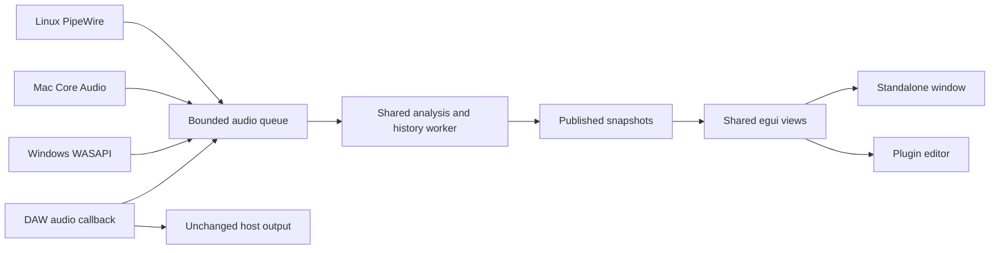

# Symphos desktop and plugin plan

Planning baseline: 14 October 2026, commit `cf18412e9381ce30bee047f37e7c3168788f8ba4`.

Priority update — 25 October 2026: Symphos is standalone first. VST3 and other
DAW integration remain future possibilities, but plugin prototypes, framework
selection and implementation are deferred. The active work is improved audio
responsiveness, clearer per-signal controls and sustained performance/reliability
validation. An Export workspace is planned for discussion after that milestone.
See the [current roadmap priorities](roadmap.md#current-priorities--25-october-2026).
The plugin investigation below is retained research for a later decision.

Keep the Rust analyzer and egui/wgpu interface. Add native macOS audio capture
behind a platform boundary and retain PipeWire on Linux. A future plugin could
reuse the shared analyzer and views. This preserves Symphos's appearance
across platforms without requiring a SwiftUI redesign or a full C++ rewrite.

The first milestone should be a Mac app that visualizes ordinary computer
playback without installing a virtual audio driver. Plugin support is a separate
milestone: the DAW supplies the audio, and Symphos displays it while passing it
through unchanged. Windows follows the Mac and Linux foundation.

The first Mac system-playback developer build is now implemented and has been
exercised with real stereo playback. See [Mac setup and validation](macos-development.md)
for current evidence and remaining release checks. Plugin and Windows work remain
proposed. The inventory below records the original planning baseline.

## Scope and decisions

| Topic | Proposed direction | Decision still needed |
| --- | --- | --- |
| First Mac workflow | Visualize system playback, confirmed | DAW plugin is a separate milestone |
| Interface | Shared egui layout and visuals, with platform shortcuts and dialogs | No Mac-specific redesign required |
| Mac architectures | Apple Silicon first; Intel after hardware and dependency validation | Whether Intel is needed for the first public download |
| Mac minimum | Provisionally macOS 14.2 or later for Core Audio taps | Raise if the selected dependencies or packaged-app tests require it |
| Linux | Preserve Omarchy, PipeWire, Wayland, and Asahi behavior | Confirm the actual Omarchy test machine and audio devices |
| Plugins | Deferred; VST3/Ableton Live remain candidates for a future milestone | Whether to build an embedded plugin or standalone sender, host coverage, and distribution model |
| Distribution | Direct downloads first, signed/notarized on Mac | Free/open-source versus paid packaging; Apple signing account |
| Website | Separate static landing page, backed by verified release metadata | Domain and launch timing |

The user confirmed computer audio first and Ableton Live as the primary DAW.
Distribution remains undecided. The local machine reports macOS 26.6.1 on arm64,
with Xcode selected; Rust has now been installed for implementation and testing.

## What the repository already gives us

| Area | Current evidence | Consequence |
| --- | --- | --- |
| App and rendering | `src/main.rs` uses eframe 0.36.1 with wgpu; modules live in `src/modules/` | Reuse the visual implementation; validate Metal rendering on Mac |
| Audio | `src/audio.rs` imports PipeWire unconditionally; `AudioEngine` owns a PipeWire command sender | Mac compilation needs a real backend boundary, not only a UI port |
| Dependencies | `Cargo.toml` declares PipeWire globally and enables Wayland/X11 | Scope OS dependencies; preserve Linux features and its PipeWire 1.0 API baseline |
| Source identity | `AudioSource` exposes `global_id` and `node_name`; `src/app.rs` selects by node name | Replace UI-facing identifiers with opaque backend-qualified IDs |
| Analysis | A bounded `rtrb` ring feeds a worker; `ArcSwap<AnalysisFrame>` publishes snapshots | The existing separation is suitable for both device and DAW input |
| History | Capture history is produced independently of visible panes | Preserve hidden-pane history, pause behavior, and capture-epoch resets |
| Theme | `src/theme.rs` loads Omarchy state, falls back through an Omarchy command, then uses Symphos Dark | Keep Omarchy integration on Linux; use the built-in theme elsewhere |
| Platform details | XDG diagnostic paths, Linux desktop files/installers, hardcoded Ctrl labels | Add Mac paths/bundle metadata; shortcuts already use `Modifiers::COMMAND` in several bindings |
| Plugin hazards | Standalone startup initializes global logging/panic hooks; release uses `panic = "abort"` | Do not call standalone startup inside a DAW; audit host-safe failure behavior |
| Validation | `.github/workflows/ci.yml` runs Ubuntu formatting, lint, tests, and release build | Add Mac and later Windows coverage; hosted CI cannot establish Omarchy hardware compatibility |

The roadmap already anticipates platform backends and DAW bridges. This plan
pulls those investigations forward without requiring the scene editor first.
The [architecture](architecture.md), [development process](development-process.md),
and [performance workflow](performance-workflow-2026-09-08.md) remain relevant.

## Native audio strategy

An audio input device and the sound currently playing through speakers are
different sources. Opening the default microphone does not capture browser,
music-player, or DAW playback. A cross-platform device library alone should not
be treated as proof of system-output capture.

| Runtime | System playback | Microphone or interface | Who owns the audio device |
| --- | --- | --- | --- |
| Linux standalone | Existing PipeWire sink monitor | Existing PipeWire source | Desktop audio server |
| Mac standalone | Core Audio process tap and private aggregate device | Core Audio input, directly or through CPAL | macOS audio system |
| Windows standalone, later | WASAPI shared-mode loopback | WASAPI input; evaluate other APIs only when needed | Windows audio system |
| DAW plugin | Audio routed to the plugin's track/bus | Whatever the DAW routes to it | DAW; plugin opens no hardware device |

### Mac system audio first

Prototype Apple's **Core Audio taps** in a minimal `.app` with a stable bundle
identifier. Apple's sample documents macOS 14.2 or later, an
`NSAudioCaptureUsageDescription` purpose string, and a system-audio permission
prompt when capture starts. A tap can capture a process or group of processes
through an aggregate device. This is an OS capture API, not a custom driver.
[Apple sample](https://developer.apple.com/documentation/coreaudio/capturing-system-audio-with-core-audio-taps).

Start with a nonmuting system mix. Keep the user's output device and playback
unchanged. Use a private tap/aggregate device, release them on stop, and verify
cleanup after failures. Define whether “System audio” follows the default output
or spans multiple outputs through the prototype; do not assume those semantics.
Per-application selection can follow after the basic path works.

Use a small macOS-only native bridge where necessary, with explicit ownership
and lifetime rules at the Rust boundary. Prefer supported bindings when they
cover the needed APIs; choose Objective-C/Objective-C++ or another small bridge
after examining that coverage. Keep native objects out of UI and analysis types.

The prototype must cover permission grant, denial, revocation and retry; silence
versus missing permission; speakers, headphones, Bluetooth and USB interfaces;
default-device changes; sleep/wake; and 44.1/48/96 kHz formats where available.
Test the bundled app launched from Finder, since Terminal permission behavior
is not sufficient evidence for a downloadable app. Unsupported or protected
audio paths should produce an understandable limitation rather than an endless
“Connecting” state.

ScreenCaptureKit is the fallback investigation if taps fail a required workflow
or older OS support becomes important. Its capture and permission flow should be
evaluated separately. Virtual routing tools such as BlackHole can be optional
advanced routing, but should not be the first-run requirement.
[ScreenCaptureKit](https://developer.apple.com/documentation/screencapturekit).

For explicit microphone/interface capture, evaluate CPAL's Core Audio backend
against a small direct Core Audio implementation. Request microphone permission
only when that source is chosen, with the appropriate usage description.
CPAL is a candidate for device I/O, not the decision for Mac system capture.
[CPAL](https://github.com/RustAudio/cpal).

### Linux and Windows

Retain PipeWire's native source discovery and sink-monitor implementation.
Preserve automatic speaker preference, never automatically choose a microphone,
and never override an explicit session choice when another device appears.
Do not replace the Linux backend with CPAL as part of the Mac port.

For Windows, add WASAPI loopback after the common interfaces settle. Microsoft's
loopback API captures playback at a rendering endpoint in shared mode. Exclusive
audio paths and DAW ASIO routing need separate validation; a plugin is the more
direct route to a DAW track. ASIO is not a prerequisite for ordinary Windows
desktop playback capture.
[Microsoft loopback documentation](https://learn.microsoft.com/en-us/windows/win32/coreaudio/loopback-recording).

## Shared architecture



These are alternative producers per instance, not multiple writers sharing one
SPSC queue. Begin with modules inside the existing package; extract workspace
crates when the second entry point makes ownership clear:

- `symphos-core`: samples, analysis, history, settings and portable tests.
- `symphos-ui`: views and visual settings, independent of device ownership.
- `symphos-desktop`: eframe lifecycle and OS-specific audio/platform services.
- `symphos-plugin`: host lifecycle, audio buses, state and embedded editor.

First isolate `src/audio.rs` into common types and a Linux implementation.
Use target-specific Cargo dependencies and `cfg(target_os = ...)` at module
boundaries. Non-Linux builds must not discover or link PipeWire. Preserve Linux's
Wayland/X11 capabilities; verify selected wgpu backend features, including Metal,
against the actual locked dependency graph. wgpu supports native graphics
backends across the intended platforms. [wgpu](https://wgpu.rs/).

The common capture contract should include source ID/kind/capabilities,
enumeration, start/stop, format and channel mapping, permission/device-loss/error
states, timestamps and dropped-frame counts. Preserve backend details in
diagnostics without exposing PipeWire IDs as universal device identities.

Make sample-format changes coherent with queued data. A generation or equivalent
stop/drain/restart handshake must prevent old-rate samples being analyzed with
new-rate metadata. Reset histories at the same boundary. Normalize input into
the current stereo float contract: explicitly duplicate mono and choose a
documented channel pair for multichannel inputs. Negotiate the real input rate;
do not force every source to 48 kHz or silently downmix surround audio.

Capture callbacks only copy/convert into preallocated bounded storage and update
safe counters. No FFT, GPU calls, logging, file I/O, locks, allocation, or blocking
IPC belongs there. Overflow drops analysis data and records the gap; it must
never delay playback. Keep the UI and analysis worker independently scheduled.

Move theme lookup, diagnostic directories and window commands behind platform
services. Retain XDG behavior on Linux; propose `~/Library/Logs/Symphos` for Mac
logs and Application Support for future saved settings. Mac shortcuts should
display Cmd where bindings already use the platform command modifier. Plugin
views must delegate window management to their host.

## Plugin investigation

Status: deferred. The acceptance criteria and framework comparison below apply
only when this workstream is explicitly resumed; they are not current tasks.

A useful first plugin is a mono/stereo analyzer inserted on a track, group or
master bus. It passes samples through unchanged with zero added audio latency,
copies a bounded amount for visualization, and saves its visual settings in the
DAW project. FFT/display latency is separate from reported audio latency.
VST3 hosts supply audio in blocks; they also control bus layout and lifecycle.
[Steinberg SDK](https://github.com/steinbergmedia/vst3sdk).

Do not open system capture, change devices, or request Mac recording permission
from the plugin. Its input is the host's buffer. A plugin on one track will not
automatically see other tracks or unrelated computer audio.

### Framework decision

| Option | Advantage for Symphos | Main proof required |
| --- | --- | --- |
| Maintained Rust framework in the NIH-plug family | Reuses Rust analysis and potentially egui views | Current framework availability, bindings license, egui version, Metal/editor embedding, and Mac host reliability |
| JUCE plugin shell calling the Rust core through a C ABI | Established VST3/AU tooling and platform integration | Native editor/wgpu integration, ownership across FFI, build complexity and licensing |
| Direct VST3 SDK shell | Maximum control, current SDK has an MIT license | Much more lifecycle/editor work; avoid as the first implementation |

The original NIH-plug repository declares maintenance mode and points to a
[community fork](https://codeberg.org/BillyDM/nih-plug). Its own documentation
lists VST3 and CLAP, with GPLv3 VST3 bindings; that does not establish AU support
or compatibility with this app's egui 0.36.1. The fork's current implementation
and license still need inspection before selection.
[Original NIH-plug](https://github.com/robbert-vdh/nih-plug).

The current VST3 SDK's MIT license does not automatically change a wrapper's
separate license. JUCE modules are dual licensed under AGPLv3 and commercial
terms; a commercial JUCE license may be required depending on distribution.
Keep Symphos's existing MIT core intact and resolve the chosen plugin dependency
licenses before publishing. Free downloads and permissive source licensing are
separate decisions.
[VST3 license](https://github.com/steinbergmedia/vst3sdk/blob/master/LICENSE.txt),
[JUCE license](https://github.com/juce-framework/JUCE/blob/master/LICENSE.md).

When plugin work resumes, timebox a Rust VST3 editor prototype if VST3 is sufficient.
If AU/Logic is a first-release requirement, evaluate a JUCE shell at the same
decision gate. Select based on a working host-loaded editor and distribution
requirements, rather than rewriting the standalone app around a framework.

### Prototype acceptance

1. Pass host scans and load a real Symphos spectrum/waterfall view. An empty
   plugin window is insufficient: prove reuse of the current rendering approach.
2. Embed in the host's native parent view. Do not start a second eframe/winit
   application event loop inside the DAW. Test resizing, Retina scaling,
   focus/keyboard routing, editor close/reopen and GPU surface destruction.
3. Preserve audio exactly in mono and stereo, including bypass and stopped UI.
   Test variable blocks, sample-rate changes, silence, suspend/resume and offline
   bounce. Visualization overload or an absent editor must not affect output.
4. Exercise multiple independent instances. Closing an editor must not destroy
   processing state; unloading an instance must safely quiesce its workers.
5. Save and restore versioned visual settings with stable parameter IDs. The
   current session-only settings clipboard is not plugin state persistence.
6. Audit panics, FFI, process-global hooks and logging. Do not inherit standalone
   `issues::init()` or `env_logger::init()` behavior in the host. Do not blindly
   apply `panic = "abort"` to the plugin; define boundary error handling and
   prevent unwinding across a C ABI or callback.
7. Run the VST3 validator and representative DAWs on Mac and Linux. Add AU
   validation if AU is selected. Record exact host/OS/CPU versions.

A small sender plugin feeding the standalone app is an alternative for large
performance windows. It introduces discovery, connection lifecycle, latency and
IPC, so it is a separate product mode, not proof of an embedded plugin. If
needed, move IPC to a worker and keep the DAW callback bounded and nonblocking.

## Delivery stages and completion criteria

Each stage should be a focused change with its evidence attached. The stages
below retain the original portability sequence; plugin stages 4 and 5 are
deferred behind the standalone priorities in the roadmap. Estimate plugin work
only after that workstream resumes and embedding has been proven.

| Stage | Work | Completion evidence |
| --- | --- | --- |
| 0. Establish baseline | Set up Rust >=1.95 on Mac; capture Linux behavior and performance at the baseline commit | Omarchy source/device/GPU inventory and repeatable 30-minute run |
| 1. Isolate platform code | Extract PipeWire backend and common capture types; keep Linux defaults; add deterministic sample source | Existing Linux checks pass; Mac builds and renders synthetic audio without PipeWire |
| 2. Prove Mac capture | Minimal bundled tap prototype, then integrate system capture and explicit input devices | Finder launch, permissions, real playback, device changes and sleep/wake all pass |
| 3. Ship desktop alpha | Mac bundle/icon/paths/shortcuts, signing/notarization and download packaging; Linux regression run | Clean-machine Mac install and matching tested Omarchy build |
| 4. Select plugin shell | Rust/alternative framework investigation with real embedded view and pass-through audio | Recorded host results and framework/license decision |
| 5. Ship plugin alpha | Shared state schema, multiple instances, packaging, scans, stress tests and host documentation | Target DAWs load, restore and unload reliably; unchanged audio verified |
| 6. Extend Windows | WASAPI capture, graphics/device tests, installer and Windows host coverage | Tested desktop and plugin artifacts on declared Windows configurations |
| 7. Publish landing page | Use verified screenshots, demos and release matrix | Visitors can choose a working build and understand its audio setup |

Keep standalone and plugin minimum OS/architecture requirements independent when
appropriate. A host-fed plugin need not inherit the system-tap OS requirement,
but its actual dependency minimum still needs validation. Build Intel artifacts
only when supported by the chosen toolchain, and test native host architecture;
an ARM plugin cannot simply load into an Intel host process.

For Mac distribution, create `Symphos.app`, retain a stable bundle ID, package
icons/Info.plist/usage strings, and sign and notarize release artifacts before
advertising general downloads. Validate the downloaded, quarantined build on a
clean machine, plus upgrade and uninstall. Choose entitlements from the actual
capture path and distribution mode; terminal success is not the release test.
[Apple notarization](https://developer.apple.com/documentation/security/notarizing-macos-software-before-distribution).

## Protecting Omarchy

Mac builds alone cannot prove Linux compatibility. Preserve the existing
`cargo run --release` and `scripts/install-dev.sh` workflows and desktop identity.
Add new target-specific files rather than repurposing the Linux installer.

Keep these checks for each implementation change:

```sh
cargo fmt --all -- --check
cargo clippy --all-targets --locked -- -D warnings
cargo test --all-targets --locked
cargo build --release --locked
```

Add Mac CI once Stage 1 builds. Use a pinned Linux environment for the promised
PipeWire 1.0 baseline, plus Arch/Omarchy coverage; the existing `ubuntu-latest`
job can move and does not prove that minimum. Add core tests on all targets and
plugin-specific build/validation jobs after the plugin exists. Audit feature
resolution so workspace/plugin builds cannot silently remove Linux defaults.

| Test layer | Required scenarios |
| --- | --- |
| Portable deterministic tests | Tone frequency/amplitude, mono/stereo mapping, rate changes, overflow/discontinuities, capture resets and history/pause semantics |
| Linux session checks | Speakers auto-selected; no automatic mic; explicit choice retained; same-source selection does not restart; unplug/replug; PipeWire restart; permission/socket failure |
| Omarchy appearance | Current and legacy themes, theme changes while running, fallback theme, Wayland fullscreen, clipboard and keyboard behavior |
| Graphics and sustained use | Asahi/Apple Silicon Linux and Mac Metal; all six modules and waterfall styles; hidden/occluded panes; 30-minute playback; bounded memory and drop counts |
| Performance comparison | Same machine, source/rate, FFT, pane layout and render rate before/after; record callback drops, analysis/display latency, CPU, frame times and memory |
| Packaging | Linux install/uninstall and launcher; Mac Finder launch, clean permissions, signed download, upgrade and cleanup |

Stop and investigate reproducible regressions before promoting a release.
Agree numerical budgets after collecting the baseline; do not invent a “zero
regression” claim from a passing unit suite. Keep refactors separate from new
backends so reverting the platform change is practical. Do not label Omarchy
verified until the real Linux session checklist has been run.

## Product reference and website

[Aurora's page](https://www.joecroskey.com/Aurora), checked on 14 October 2026,
advertises a macOS 13.3+ Apple Silicon/Intel AUv2/VST3 developer preview built
with C++17, JUCE 8.0.6 and OpenGL. Its page does not establish a standalone
system-audio workflow or Linux/Windows availability. Treat it as evidence that
the plugin presentation is useful, not evidence that Symphos must use its stack.

Symphos can emphasize the combination of standalone computer-audio analysis,
DAW track analysis, a consistent workspace, and first-class Linux support as
those capabilities ship. Keep upcoming scene editing distinct from today's
analyzer. The [landing page brief](landing-page-brief.md) describes a separate
site without committing to a domain, hosting service or purchase.
