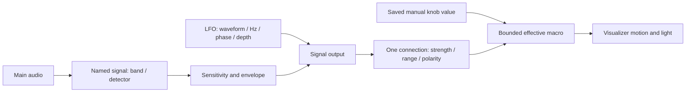

# Assignable performance macros

Every component has twelve macro slots in one horizontal row, including the
scientific instruments. New scenes show an empty macro bar. The twelve slots
belong to the scene and can mix parameters from any of its components. Selecting
a different component keeps the same macro bar. Each assigned macro shows its
target component number and type; hover for the full name. A macro controls one
parameter, identified by a stable component ID and settings field.

## Assigning parameters

Drag a numeric parameter's **label** from the right inspector onto a macro slot.
The numeric value field keeps its normal editing behavior. A highlighted slot
shows a valid drop target. Parameters are identified by stable settings field
keys rather than their displayed labels. Camera angle controls keep their degree
units when stored values use radians; logarithmic and integer controls retain
those behaviors.

An occupied slot receives the new parameter while keeping its source connection,
depth, polarity, range, and bypass state. Multiple controls may target the same
parameter; they share its manual value and enabled modulation depths add.
Right-click a macro and choose **Delete** to reset the whole slot.

## Showing and hiding

Use **Cmd-B** on Mac or **Ctrl-B** on Linux/Windows, or the **Macros** button in the
bottom toolbar. Cmd-K/Ctrl-K continues to open keyboard shortcuts. Shortcuts do
not fire while editing text or using a modal/menu.

Macro visibility and assignments are saved with projects and full-view presets.
Device selection and GUI skin preferences remain local. No audio samples,
particle state, detector histories, or instantaneous modulation values are saved.

## Manual values and modulation

Drag a knob to change its underlying parameter's manual value. Shift gives fine
adjustment; double-click resets it; clicking the percentage allows exact entry.
Drag the outer colored ring or the signed amount beside **Mod** to adjust that
slot's modulation depth. Mod bypasses its source without removing the assignment.
Changing the depth does not change the manual value or another macro.

The compact source popup contains only the parameter name, source selector, and
**Disconnect**. Create, duplicate, and configure sources in **Signals**. Sources
are never created by opening the macro bar or dropping a parameter. Deleting a
source unmaps it while retaining the parameter assignment. Disconnected providers
fade to zero and resume when connected again.

Audio/LFO values modulate the parameter within its safe range. Integer values
round, and logarithmic controls use their normalized logarithmic domain. Rendering
uses temporary effective values; inspectors and project saves retain the manual
base. Writing macro values avoids blanket history or simulation resets.
Parameters such as particle count and pattern seed retain their normal effects.

Existing named artistic source assignments are converted to parameter slots on
load, preserving their source and effective depth. Strata's automatic per-layer
frequency bank remains available as a scientific extraction path. Existing
component presets still carry their component settings; use a full-view preset or
project to save the assignable macro banks.

## Source → response → macro

Signals remains the place to manage, rename, inspect, reorder and remove sources.
The popup is the quick editing surface for the same definitions. MIDI, OSC,
Ableton and file inputs remain visible as planned integrations; they do not
receive data yet. No MIDI ports are opened by the macro controls.

## LFO signals

An LFO runs on the independent 120 Hz signal worker without an audio connection.
It supports **Sine, Triangle, Saw and Square**, **0.01–20 Hz**, **phase 0–1 cycles**,
**depth 0–1**, and **bipolar/unipolar** output. Rate edits preserve accumulated
phase; editing the phase control deliberately shifts the waveform. There is no
BPM sync yet. Its preview shows a waveform cycle; the meters show its live output.
Muting a signal fades its influence out. Re-enabling resumes it immediately.
Audio disconnection fades audio influence to zero and reconnection resumes;
independent LFO sources keep running throughout.

## Bespoke control sets

| Flux | Veroni | Strata |
| --- | --- | --- |
| Brightness | Brightness | Brightness |
| Speed | Speed | Speed |
| Expansion | Expansion | Bend |
| Impact | Swirl | Ripples |
| Swirl | Turbulence | Shimmer |
| Turbulence | Drift | Turbulence |
| Magnetism | Clustering | Twist |
| Shape | Rounding | Spacing |
| Depth | Points | Lift |
| Trails | Edges | Spread |
| Glow | Links | Trails |
| Color drift | Glow | Glow |

Flux's formation menu provides Cloud, Rings, Helix, Knot, Vortex and Petals;
Shape morphs between the orbital forms and Magnetism attracts the cloud toward
them. Audio onsets connected to
Expansion/Turbulence still provide bespoke Impact accents.

Strata's Bend/Ripples/Shimmer retain **Automatic layer bands** as a source option.
Each layer gets its own logarithmic frequency subdivision, bass at the bottom
and treble at the top, normalized when the layer count changes. The macro dot
shows the strongest layer's influence, not an average or an extra combined
source. Choosing a named source broadcasts that one source to the layers.
Scientific components continue using their raw analysis path.

## Reaction presets and persistence

Each bar has three built-in **Reaction preset** choices:

- Flux: **Breathing cloud**, **Electric orbit**, **Slow nebula**.
- Veroni: **Breathing cells**, **Electric lattice**, **Slow drift**.
- Strata: **Breathing membranes**, **Impact strata**, **Slow sediment**.

Legacy artistic reaction presets define component settings and mapping depths.
They never create channels. New assignable macro banks are saved with projects
and full-view presets. The current visual palette and pane layout remain
independent. The header preset menu provides starting points; use a component
preset or **File → Save Project** to retain your customized result.

Projects and component presets save base values, modulation connections and LFO
configuration. They exclude oscillator runtime phase, instantaneous modulation,
particle positions, detector histories, and GUI/device preferences. Older signal
files receive default LFO configuration when loaded. Older duplicate routes are
retained for recovery in Advanced, with only the first enabled connection to a
destination contributing; the performance bar disables additional duplicates.

### Inspector modulation feedback

A parameter with a macro source shows a marker in that source’s channel color
next to its inspector label, plus a moving point on its numeric value track. The
number remains the manual base value. Hover the marker for the assigned macro,
source name, signed depth, and current value. Bypassed assignments use a muted
marker. Right-click anywhere on an assigned macro, including its knob, value,
source badge, or modulation row, and choose **Remove macro** to clear the slot
and its modulation without changing the parameter’s manual setting.

The Macros dock uses the same rounded frame, adjoining channel strips, bold
headers, recessed fields, and spacing as Signals. Empty slots have neutral
headers. Assigned parameters use the app accent, and connected parameters use
their signal channel’s color in the header and modulation ring. The twelve
columns remain in a single horizontally scrolling row on narrower windows.

Macro headers can be dragged to reorder the fixed twelve slots; a thin insertion
line marks the drop position. Right-click a slot for Cut, Copy, Paste, Duplicate,
Delete, Rename, Insert empty macro, Undo last edit, and the same 70-color palette
used by Signals. Custom names, colors, order, parameter bindings, and source
mappings save with the scene. Automatic color follows the connected source.

Duplicate uses an empty slot and starts its modulation bypassed. Duplicated
controls share the parameter’s manual value. If multiple controls for that
parameter have modulation enabled, their depths add before the final safe limits.
The Macros dock is shown or hidden from the bottom toolbar or Cmd/Ctrl+B.

Scene macros are included in projects, recovery files, scene duplication and full-view
presets. Switching component type retains that component's assignments, which
resume when their type is active again. Closing a component removes its parameter
assignments from the scene bank; deleting a signal only removes the source link.
Older per-component banks are consolidated on load, prioritizing the selected
component and then other components, up to twelve slots. Original banks remain
in older component data for recovery when more than twelve were assigned.
