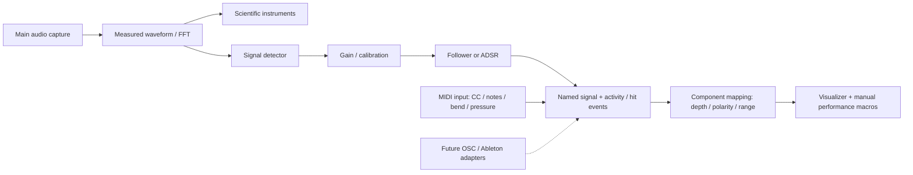

# Signals, visual mappings, and projects

The **Signals** bottom dock prepares reusable musical controls from the main
audio capture while visualizations remain visible above it. **Macros** shares
the same bottom area; opening either dock hides the other. Drag the Signals
dock’s top edge to resize it; its height is remembered locally. Settings remains the place to select the actual capture device/source.



## First use

1. Choose system playback or your default input in Settings → Audio.
2. Open **Signals** using the levels icon in the top toolbar. The default input
   stays pinned at the far right, with a live spectrum and stereo meters. It
   cannot be deleted and is not saved as a removable scene channel. Its
   **Audio settings…** button opens capture settings. Right-click the blank
   workspace to add **Audio**, **LFO**, or **MIDI** channels; add audio detectors
   and control processors using **+ Insert** on a channel.
3. Click a channel name. Its right inspector edits the frequency range,
   sensitivity, and response. Input and output meters help distinguish capture
   from shaping. The input meter shows measured activity before envelopes, so
   centered stereo can show input while its balance output remains zero. Bass hits has a hit indicator, threshold, and retrigger/hold.
4. Right-click a visual pane and choose **Inspect**, open Flux, Veroni, or Strata's inspector, and select
   Audio mappings. Choose a named signal and a destination. Depth, inversion,
   and range belong to this mapping only.
5. **Edit signal** opens its shared configuration. To make an independent source,
   duplicate it in Signals, then assign the copy in Visualize.

Every visualizer’s **Driven by** dropdown separates an **Always available**
default input from **Scene signals**, even when no scene channels exist. The
master strip follows the input selected in Settings. Inspecting it opens its
capture information; custom channels provide independent inserts and processing.

Signals shares the inspector panel background and compact themed menus.
Channel colors remain in headers, meters, and activity traces; selecting a
channel adds a subtle border without changing its background.

Channel knobs adjust **visual influence** (0–200%, with 100% as unity). Drag
vertically, hold Shift for fine adjustment, double-click to reset, or type a percentage.
**M** mutes a channel; **S** solos it. Multiple solos can be active together, and
Mute still silences a soloed channel. These controls affect visual modulation.
Mute and Solo are saved with each scene. The dock has a 320-point minimum height
when space allows; graphs expand with its height. Horizontal scrolling appears
only when existing channels exceed the available width.
Right-click a track header or body for **Cut, Copy, Paste, Duplicate, Delete,
Rename, Insert new channel**, and a 70-swatch channel color grid (14 columns × 5 rows). Paste and Duplicate
insert after the clicked channel. Right-click the open workspace after the last
track for Add channel, Paste, and Undo delete / cut. Only existing channels are
displayed; deleting a track closes the gap. Copy uses
an internal project channel clipboard. Cut removes the channel and clears its mappings; Paste
moves its original source identity without restoring removed mappings. Copies and duplicates
receive fresh identities and independent detector settings. Opening a different
project clears the clipboard. Rename supports Enter to apply and Escape to cancel.

Colors are saved with channels and follow their meters, traces, and macro source
rings through reorder, duplication, and preset import. Dark header colors use light
text for readability. Drag a header to reorder; a thin line marks the insertion
boundary, including at the end of the track list. **Undo delete / cut** restores the
source identity, settings, and order. Double-click a colored channel title to
rename it inline; typing replaces the selected name. Enter commits, Escape
cancels, and clicking away commits a valid name. Delete or Backspace removes the
selected channel (or selected insert), while either key edits text during a
rename. The permanent default input cannot be renamed or deleted.
Track order is saved in projects; vacant
slots in older projects are removed when displayed.
The mixer scrolls horizontally and vertically when space is limited. Deletion
clears that channel's mappings across all retained visualizer configurations.
Undo restores the source but does not recreate mappings. Disconnected sources
remain assigned and resume when reconnected; deleted sources are unassigned. The inspector lists linked destinations for currently
selected component types in the workspace, including retained closed pane slots.

## MIDI inputs (macOS)

1. Open **Symphos → Settings… → MIDI** (`Cmd+,`). Enable a hardware input or
   use the enabled **Symphos Input · virtual** destination. Ports refresh automatically.
2. Right-click empty space in Signals → **Add channel → MIDI control**. Alternatively,
   switch an existing channel’s Source to MIDI. Inputs never create channels automatically.
3. Click the channel and open its Source inspector. Choose **Learn MIDI**, then move
   a control or play a note. Learn captures the port, channel, message and number.
   You can also enter them manually, choose all enabled ports/channels, or Any note.
4. Connect that signal to a scene macro using the macro’s source picker. Use the
   macro ring for depth; the signal’s Output tab still supplies normalization and
   final smoothing. Muting, soloing and influence work like other signals.
   For a fader to cover a macro’s full range, set the macro base to its minimum
   and depth to +100%; the MIDI signal then supplies its 0–1 travel.

| Message | Behavior |
| --- | --- |
| Control change | Absolute CC 0–127 becomes 0–1; holds between messages |
| Note velocity | Strike velocity while held; zero on release; Any note uses the strongest held note |
| Note gate | 1 while matching notes are held, 0 when all are released |
| Pitch bend | 14-bit position becomes −1…+1, with exact zero at center |
| Channel pressure | Channel aftertouch becomes 0–1 |
| Note pressure | Per-note aftertouch becomes 0–1; cleared on note-off |

MIDI strip previews show incoming data before normalization, smoothing and visual
influence. CC and channel pressure use stepped histories with native 0–127 values;
pitch bend has a centered zero line and signed 14-bit values. Notes and per-note
pressure use a four-second piano roll with held-key highlights and intensity
shading. Brief strikes remain visible after release. The In/Out meters below the
preview continue to show the channel’s processed signal.

Notes support polyphony, velocity-zero note-off, sustain pedal, and All Notes Off /
All Sound Off. **Reset held MIDI values** clears stuck notes/controllers without
closing ports. MIDI values do not expire simply because a controller is idle.
Disabling/unplugging a selected input clears its held state and fades influence
including mapping offsets; reconnecting resumes immediately on new data.

For Ableton Live, enable **Track** for its MIDI output to **Symphos Input**, then
route the MIDI track there and choose a channel. In Symphos select the corresponding
port/channel or use Learn. This uses standard MIDI, not a Live-specific API.
See [Ableton’s routing documentation](https://www.ableton.com/en/manual/routing-and-i-o/).

Port enablement is saved locally in `midi-inputs.json`; project scenes save the
binding (port ID, channel, message, number), signal shaping, and macro assignments.
Loading a project does not change which devices are enabled. Missing devices remain
assigned and can be replaced in the inspector. The virtual destination has a stable
logical identity across app restarts. Learn state, held notes and live values are
never saved in a project.

Current scope: macOS CoreMIDI input, MIDI 1.0 channel messages. Configure relative
encoders to send **absolute CC** for this version. MIDI clock/transport, SysEx,
MIDI file playback, output feedback, and a Linux MIDI backend are not implemented.
OSC, direct Ableton integration, and audio file inputs remain disabled placeholders.

## What the detectors mean

| Recipe | Measurement | Output |
| --- | --- | --- |
| Overall intensity | Full-mix RMS | Unipolar level |
| Band energy | Square root of summed FFT-bin power within the selected band | Unipolar level |
| Bass hits | Positive changes above a slow low-band level baseline, with threshold and retrigger interval | Timestamped hit + shaped envelope |
| Spectral change | Mean positive difference between consecutive 96-band logarithmic spectral levels, divided by frame interval | Unipolar activity; optional hit response |
| Stereo balance | Signed L/R RMS difference over sum, gated by mix level | Bipolar control |

Bass hits estimates percussive activity in a mix. It does **not** isolate kick
instruments. Spectral change is an onset-like measure, not melody extraction,
vocal recognition, beat-grid tracking, or song-section detection. Its positive
spectral-difference principle is related to
[librosa's documented spectral-flux onset measure](https://librosa.org/doc/0.11.0/generated/librosa.onset.onset_strength.html),
but this implementation uses Symphos's existing logarithmic features rather than
librosa's Mel transform or vibrato-suppression filter. No new DSP dependency is used.

Level followers expose attack/release; gated and hit modes additionally expose
decay/sustain and threshold. Hit hold also sets a minimum retrigger interval
(with an 80 ms floor). Reusable channel shaping runs once, not separately for
each destination. Existing gain/noise-floor/curve/adaptive calibration is retained.

## Mapping and performance

Named mappings consume already-shaped signals. The calculation is:

`(range_min × availability + signed_value × (range_max − range_min)) × depth`

Invert flips the sign. Component audio amount then scales the mapping, and
multiple mappings add with a bounded total of −4 to +4 per target. A nonzero
range minimum intentionally adds an offset while a source is available. It
fades with availability on disconnect, and missing sources contribute nothing.

Manual/base values remain saved settings. Live influences are runtime-only.
Flux supports its original movement, expansion, swirl, turbulence, brightness,
size and steering destinations plus Impact, Magnetism, Orbit shape, Depth,
Trails, Glow and Color drift. The last six modify normalized macro targets before
performance smoothing; Impact uses timestamped hit events and its intensity
control. Manual Burst remains available. There are twelve performance macros;
size and steering remain additional mapping destinations.

Pausing a pane freezes its consumed frame and visual clock. Shared channels and
other panes keep running. Resume uses current signal values and acknowledges
current event IDs, without replaying hits accumulated during pause. Hit events
carry monotonically increasing runtime IDs, strength, and monotonic timestamps.
A consumer accepts a new hit once, only while it is less than 100 ms old; this is
realtime latest-event delivery, not a recording or replay queue.

Scientific waterfall, waveform, spectrum, spectrogram, scope and stereo displays
continue to receive raw measured frames. A normalized signal never substitutes
for their waveform/FFT. **Strata's automatic layer bands remain a local band
bank**, with independent envelopes and logarithmic redistribution when layer
count changes. Its inspector labels this exception explicitly. Choosing a named
signal instead drives the selected layer/all layers from that shared scalar.

## Timing, state, and disconnection

- A separate worker evaluates shared signals at approximately 120 Hz and publishes
  immutable snapshots. It runs even with no renderer, while Signals is visible,
  or while a pane/window is hidden.
- Signals follow the active capture runtime when macOS replaces its analysis
  session, including reconnects whose sequence and epoch IDs restart.
- Cached FFT features are reused. No new allocation, locking, UI work, or I/O is
  added to the capture callback. Signal count is bounded at 512, and component
  mappings retain the existing 24-route limit.
- Frames have capture epoch and sequence identity. No new frame for 500 ms marks
  capture stale. Explicit capture disconnects can begin the fade immediately.
- Output and availability decay exponentially with a 250 ms time constant; both
  snap to zero below 0.001 availability (about 1.7 seconds). Silence with fresh
  frames remains live; it is not treated as a disconnected device.
- Reconnection resumes processing on the next fresh frame/worker step, subject
  to the signal's configured attack. It does not wait for another user action.
- Source/FFT/sample-rate changes discard detector history, preserving prior output
  for a disconnect fade. Changing one detector's input, method, response mode or
  band resets only that channel. Capture reconnection preserves artistic particle
  simulations while clearing measurement histories.

The current stale threshold assumes normal analysis rates (the application's
standard options are 30 Hz and above). MIDI is event-driven and retains held values while its input is connected;
future slow external providers need their own freshness/value contracts.
`Input` supplies stable logical provider aliases; `OutputKind`, `Sample`, and
`Event` distinguish intensity, polarity and hits. MIDI bindings store input IDs, channel and message filters. Future network adapters
will need versioned addresses and logical bindings. The disabled placeholders are
not connection implementations; direct Ableton audio and transport remain separate
from the standard MIDI track route above.

## Projects and presets

Use **File → New Project**, **Open Project**, **Save Project**, or **Save Project As**. On macOS,
these live in the native menu bar and use AppKit's file choosers. The shortcuts
are Cmd+N, Cmd+O, Cmd+S and Cmd+Shift+S. Save updates the current project; Save As chooses
a new location. Other desktops expose File in the app navbar with Ctrl shortcuts
and the portable path dialog. The separate Project toolbar button has been removed.
Save before opening a different creative setup if you want to keep that version.
Projects use version 2 of the `.symphos.json` document format. Version 1 projects
open as one initial scene without altering the original file until you save.

The shared top **Scene** selector recalls Signals and Visualize together. Each
scene stores its own logical input aliases, signal definitions/IDs/order, component
instance IDs, pane layout, mappings, inline gradient stops, camera/geometry,
manual macro values, and analysis configuration. A project stores every scene,
their order, names, and the active scene. Switching retains outgoing edits; saving
the project captures all scenes, including edits in inactive scenes. **+** duplicates
the complete current setup; **New empty scene** creates an empty canvas and source
bank. Rename, move earlier/later, and delete are in the scene menu. The last scene
cannot be deleted. Scene recall resets detector/visual runtime while keeping the
physical audio capture connection running. Scene transitions are immediate.

Projects exclude GUI skin/zoom,
physical device selection, window geometry, audio samples, visual histories,
envelope runtime and event queues. Named local swatch/palette libraries remain
local; the actual chosen custom gradient is embedded in component settings.
The recent path is kept separately in the local workspace directory.

Writes use an atomic sibling temporary file and rename. Invalid/unsupported
projects are left untouched and do not replace the open workspace. The regular
session auto-save also stores signals, and development storage stays isolated
under `target/dev`.

Sources and visualizers have separate lifecycles. Switching types, opening a
macro popup, adding a component, and applying a visualizer preset never add
sources. Source creation, copying, and duplication are manual actions in Signals.
Old local artistic routes stay disabled until a named source is selected; they do
not migrate into channels. Automatic Strata frequency banks remain local. IDs
survive channel rename/reorder. Pane instance identities remain separate from tile
indices and survive project round-trips.

Saved component/full-view presets embed referenced signal descriptions. Applying
one reuses only matching sources already in the project; unavailable dependencies
are unassigned and disabled. Presets do not import sources. Layout-only presets
contain geometry only. Opening a project or recalling a scene explicitly restores its saved source
bank and mappings together. Source edits in one scene do not affect other scenes. Reaction presets preserve the user's source assignments. Existing factory and
user presets remain in **Scene → Visual preset library…**; component presets are
also reachable from the component inspector. These are reusable pieces, not scenes.

The recovery workspace retains every scene and the current project path across
app restarts. New/Open Project offers Save all scenes, Discard changes, or Cancel
when the current project has edits. Future project media will be owned by the
project and referenced by scenes; media import/collection and crossfades are not
implemented in this pass.

## Validation

Tests cover tone/band rejection, signed balance, spectral rises versus sustained
spectra, transient event deduplication, shared output/local mapping depth, stale
fade and recovery, manual source lifecycle, independent duplicates, missing
references, preset ID collisions, actual project disk save/open, invalid-file
preservation, component ID validation, and small/large mixer layouts. A development
integration test drives the shared worker from generated audio without any UI.

Run `./scripts/dev.sh --check`. Manual timing:

```sh
MACOSX_DEPLOYMENT_TARGET=14.2 cargo test --features development signal_processing_timing -- --ignored --nocapture --test-threads=1
```

On this Mac, cached 8192-point FFT features measured about 0.007 ms per worker
step for 48 channels and 0.087 ms for the 512-channel limit. These are CPU-only
manual probes, excluding FFT construction and GPU presentation. Existing render
probes measured Flux 6k/20k particles at 2.86/10.13 ms, Strata default/max detail
at 1.02/6.98 ms, and Veroni 128/240 cells at 0.44/1.04 ms. The development app was
also running; these are not guaranteed frame budgets.

Native checks were performed on macOS, including source selection, frequency and
ADSR editors, the Flux named mapping inspector, and saving/reopening a project through the
actual UI. A real Omarchy/PipeWire/GPU session has
not been tested locally; the capture backends remain unchanged.

The original Signals milestone passed formatting, both Clippy configurations,
207 standard tests, 218 development tests, and 4 supervisor tests. Additional
performance/LFO coverage is described in the performance guide. Seven manual probes are
ignored in the default suites; the signal and renderer timing probes were also run.

## Direct performance connections and LFO

Flux, Veroni and Strata now offer twelve-knob performance rows with source
badges and compact source mapping popups. See [the performance guide](performance-modulation.md)
for draggable modulation strength, live rings and shared sources,
reaction presets, and the new free-running LFO source.

## Normalize a narrow source range

In a channel’s signal inspector, **Output tab → Normalization → Normalize output** remaps the
shaped detector/envelope output before the visual-influence fader. Set **Input
low** and **Input high**, or choose **Learn range · 5 s** while the relevant music
is playing. Learning observes live, changing raw values, and leaves the previous
range intact when there is no variation or live input.

For input limits 0.50–0.55, 0.50 becomes 0, 0.525 becomes 0.5, and 0.55 becomes 1.
Values outside the limits are clamped. The transfer graph shows this relationship
and the current signal. Normalization is optional and saved with the channel in
projects; it applies to every mapping using that channel. Existing sources retain
their previous behavior. A bipolar source can also be converted to 0–1 by choosing
input limits -1 and +1. Calibration is applied before the source fader, and a
disconnected source’s resulting influence still fades to zero.

To use the entire manual knob range, set its base to 0% and its modulation depth
to +100%. Higher base values and smaller depths produce an offset or smaller
movement; the manual base and the shared source range remain independent.

## Smooth the final output

Each signal inspector includes **Output tab → Smoothing → Smoothing ms**, with Off,
50 ms, 200 ms, and 500 ms presets. Try 200 ms for less jumpy motion; increase it
for slower movement or reduce it to keep sharp hits. Exact values up to 5000 ms
are supported. Zero bypasses the filter, which is the default for existing and
new channels.

The signal path is detector → response/envelope → normalization → influence
fader → output smoothing → macro mappings. This final filter affects the channel
output graph, meters, and every mapping using that source. It preserves signed
signals and is based on elapsed time rather than frame count. The millisecond
value is a filter time constant: after one interval it covers about 63% of a
change, and after three about 95%. Hit event detection remains immediate.

Smoothing is saved in the project and copied when duplicating a channel. Muted
or disconnected channels still use the existing short fade; reconnecting starts
with the next live value, independent of the smoothing duration.

## Signal inspector navigation

Signals and Visualize share the same inspector header, icon-tab rail, section
framing, disclosure groups, striped property rows, fonts, spacing, and themed
fields. The signal inspector follows the same width as the component inspector.
Its header stays visible while properties scroll; the close button and the
navbar inspector toggle both retract it.

- **Source:** channel name, provider, and detector.
- **Detection:** frequency selection and sensitivity; **Oscillator** for LFOs.
- **Response:** follower or ADSR envelope and hit thresholds (audio channels).
- **Output:** normalization, range learning, and final output smoothing.
- **Mappings:** visualizer parameters consuming the selected channel.

Each channel remembers its selected tab for the current app session.

The top navigation has a knob icon for Macros and a levels icon for Signals,
beside the inspector toggle. These buttons open the existing bottom docks;
keyboard shortcuts and saved open states are unchanged. The footer keeps Info
View on the left, followed by measured FPS and capture sample rate. Clicking FPS
opens the local 30/60/90/120 target selector, shared with Settings. The labeled
System audio meters on the right show the master capture before Signals inserts
or channel gain (Audio input/Demo audio is labeled accordingly when selected).
The display target never changes audio analysis or recording frame rate.

### Inline macro titles

Double-click a macro’s colored title to edit its name in place. Enter confirms,
Escape cancels, and clicking away commits a valid name. Click a macro and press
Delete or Backspace to clear that slot, including its parameter assignment and
modulation link. The visualizer’s manual parameter value stays unchanged.
Scene Undo restores the deleted macro; the macro context menu also offers
**Undo last edit**. Delete and Backspace edit text while a name or other text
field has focus.
